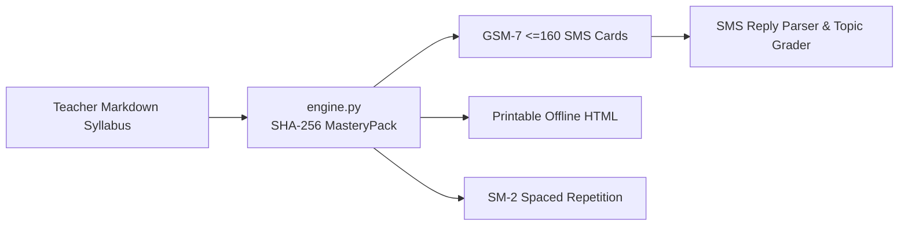

# edupack

[](https://github.com/codesphere-u/edupack/actions/workflows/ci.yml)
[](LICENSE)
[](pyproject.toml)
[](pyproject.toml)

**Offline-first curriculum Markdown-to-mastery assessment compiler, SuperMemo SM-2 spaced repetition engine, GSM-7 SMS study cards, printable zero-CDN HTML worksheets, and batch SMS grader.**

- **Mission Domain:** Education & Knowledge Accessibility
- **Stack:** Pure Python 3.11+ (zero runtime third-party dependencies, `mypy --strict`, `ruff`, `pytest`)
- **Maintainer:** Codesphere Innovations (U) Limited (`codesphere-u`)

---

## Problem Solved

Secondary schools, TVET institutes, and rural learning hubs without reliable internet need an authoring workflow that converts teacher-written plain Markdown syllabi into offline printable exams, SMS study cards, spaced-repetition reviews, and topic-mastery grading.

## Key Features

- Structured Markdown parser producing SHA-256 content-addressed `MasteryPack` artifacts.
- Strict `<=160`-char ASCII GSM-7 SMS study card formatter and zero-CDN print-ready HTML worksheet renderer.
- Authentic SuperMemo SM-2 spaced-repetition scheduler (`sm2_review`) with lapse resets.
- Compact SMS response parser (`'1C 2B'`) and per-topic classroom mastery grader (`grade_submission`).

## Architecture Overview



See [docs/architecture.md](docs/architecture.md) for module-level design details.

## Installation

```bash
git clone https://github.com/codesphere-u/edupack.git
cd edupack
uv sync --extra dev
```

Or install in editable mode with standard `pip`:

```bash
pip install -e ".[dev]"
```

## Quick Start (CLI)

```bash
edupack demo
edupack compile syllabus.md --html-out exam.html
```

## Quick Start (Python API)

```python
from edupack import Sm2State, compile_markdown_pack, sm2_review
from edupack.cli import DEMO_MD

pack = compile_markdown_pack(DEMO_MD)
next_review = sm2_review(Sm2State(), quality=5)
assert len(pack.items) == 2 and next_review.interval_days == 1
```

## Testing & Quality Gates

```bash
uv run ruff check src tests
uv run mypy src
uv run pytest -v
```

## Security, Contributing & Roadmap

- **Security:** See [SECURITY.md](SECURITY.md) for responsible disclosure procedures.
- **Contributing:** See [CONTRIBUTING.md](CONTRIBUTING.md) and [CODE_OF_CONDUCT.md](CODE_OF_CONDUCT.md).
- **Changelog & Roadmap:** See [CHANGELOG.md](CHANGELOG.md) and [ROADMAP.md](ROADMAP.md).

## License

MIT License — see [LICENSE](LICENSE).

## Support & Contact

Open an issue on [GitHub Issues](https://github.com/codesphere-u/edupack/issues) or contact `codesphereinnovationz@gmail.com`.
